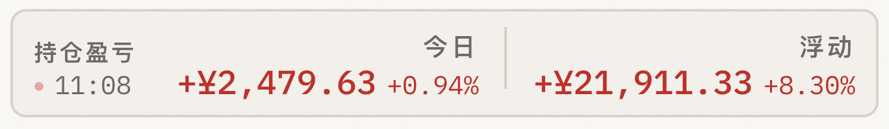
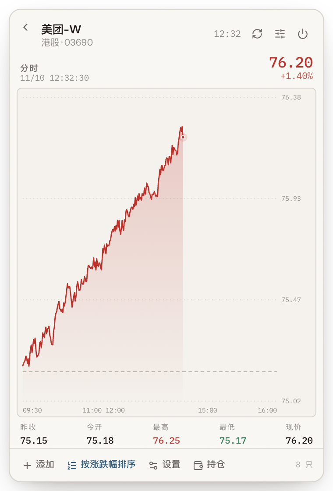
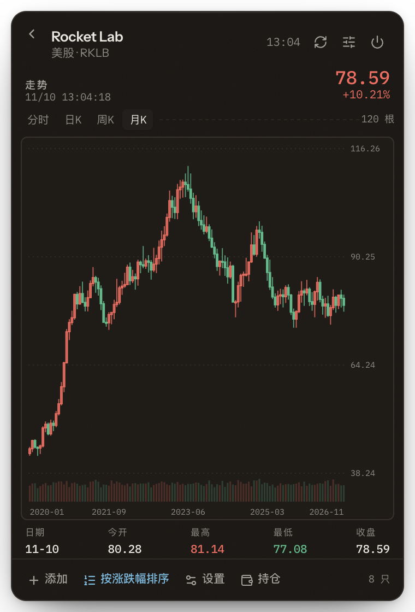
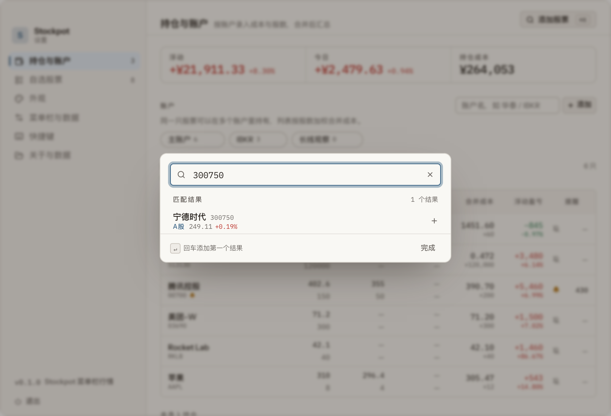
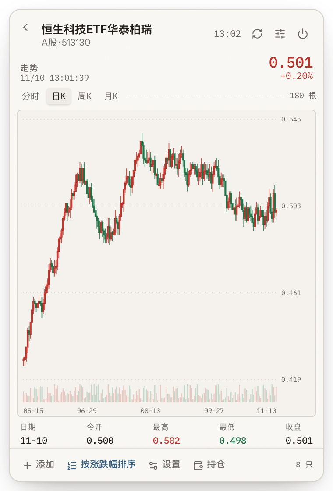
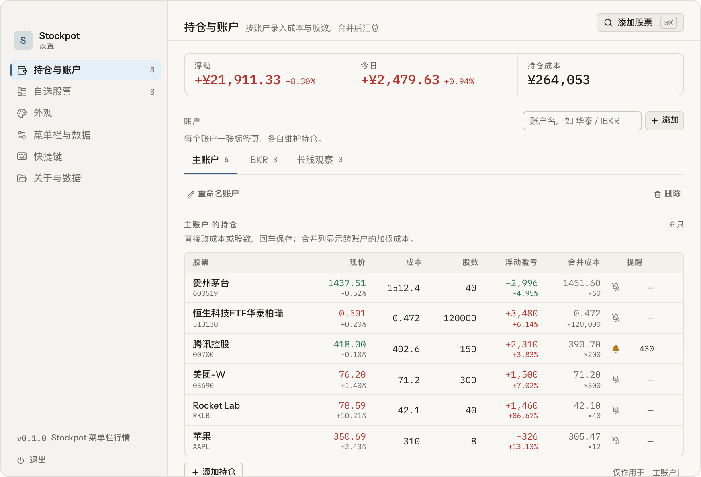
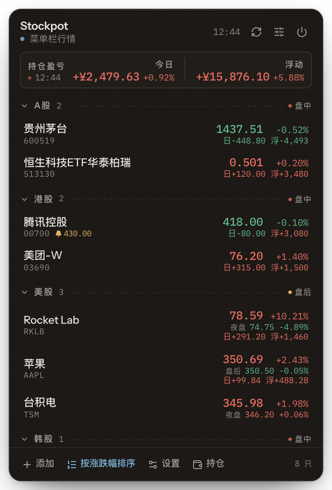
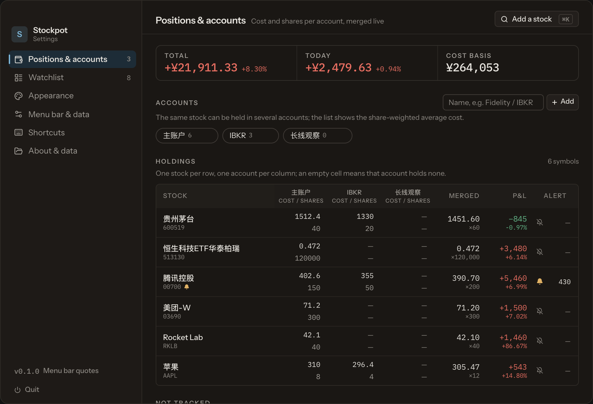

# Stockpot

A quiet macOS menu bar ticker for A-shares, Hong Kong, US and Korean stocks.
Built with Tauri 2, React 19, Vite and shadcn-style primitives, with a Rust
backend that normalises four free quote feeds.

Stockpot is a from-scratch rewrite of the feature set in
[VGEAREN/Stockbar](https://github.com/VGEAREN/Stockbar) (SwiftUI), keeping the
same habits — glanceable menu bar, intraday chart on click, per-stock cost and
share count, one-shot price alerts — while adding a light/dark theme,
three languages, and a proper landscape settings window for managing holdings.

---

## Screenshots

| Menu bar panel | Intraday chart |
| --- | --- |
|  |  |

| Monthly candles (dark) | Add a stock |
| --- | --- |
|  |  |

| Daily candles | Positions (settings window) |
| --- | --- |
|  |  |

| Dark panel (odometer P&L) | Dark settings |
| --- | --- |
|  |  |

---

## Features

- **Four markets in one list** — Shanghai, Shenzhen, Beijing, Hong Kong, the US
  (including pre/post/overnight) and Korea, grouped and collapsible.
- **Bookkeeping** — the app's main window: a ledger fed by manual entries and by
  the CSV exports from WeChat Pay and Alipay. Monthly overview with category and
  daily breakdowns, a spending calendar, a filterable ledger, and import
  history. Money is stored in integer cents.
- **Menu bar readout** — icon plus either the selected stock's price/change, or
  today's P&L, total P&L, or both. P&L always carries a sign and can be shown as
  an amount, a percentage of cost basis, or both (`日-¥650 -0.34%`). Long names
  truncate instead of shifting the bar.
- **Charts at four granularities** — intraday minute line for the full session
  (US spans 04:00–20:00 ET with pre/open/post bands; A-share and HK axes squeeze
  the lunch break so morning and afternoon line up), plus daily, weekly and
  monthly candlestick charts with a volume gutter. One toggle switches between
  them without losing the quote header. Hovering snaps a crosshair to the
  nearest sample and shows a floating readout — time and price on the intraday
  line, date and OHLC on candles. The candle views also zoom with the wheel
  (anchored at the cursor, 12 bars minimum) and pan by dragging; the header shows
  the visible window as `68/180` while zoomed.
- **Multi-account portfolios** — hold the same stock in several accounts at
  different costs (e.g. one broker at 1512.40 × 40 and another at 1330 × 20).
  The list, the totals and the menu bar all show the share-weighted average
  (1451.60 × 60 here); the row tooltip breaks the average back into lots.
- **Portfolio P&L** — cost per share and share count per account, converted to a
  display currency of your choice, with today's P&L and total P&L in the header.
- **Price alerts** — one target per stock; the direction (rise to / fall to) is
  fixed from the first quote after arming, the alert fires once, turns itself
  off, and uses the overnight tape for US stocks when it is live.
- **Themes and languages** — light/dark/system, and 中文 / English / 日本語.
- **Colour convention** — red-up/green-down (China/HK) or green-up/red-down
  (US/EU), switchable independently of the theme.
- **Safe persistence** — one readable `stockpot.json` plus ten rolling backups,
  written atomically; a corrupt file falls back to the newest good backup.
- **Launch at login** — a login item toggle, off by default.

## Menu bar only

The bundle ships an `Info.plist` with `LSUIElement = true`, so Stockpot has no
Dock tile and never appears in ⌘Tab. Both windows are borderless with custom
title bars; the panel is a rounded popover and the settings window keeps the
macOS traffic lights at top-left. Drag either window by its top bar — the
traffic-light strip on the left of the settings sidebar stays clickable.

The tray panel dismisses when you click away from it, like a native flyout.
That dismissal is deliberately conservative: a click *inside* the panel never
closes it. Windows emits a short focus flap when the WebView2 control activates
and can report a stray blur on the first click, so the handler ignores blur
events during a grace window right after showing and skips any blur that arrives
while the pointer is still over the panel (`src-tauri/src/tray.rs`).

## Candle zoom

Daily/weekly/monthly charts keep a visible window over the series.

- **Drag to select** a horizontal range — the shaded band with its date span
  (`07-15 → 09-21 · 69`) becomes the new window on release, the way W&B charts
  work. A plain click does nothing.
- **Wheel** zooms around the pointer in ~12% steps, so every notch is a distinct
  level rather than snapping between two.
- **Double-click** resets to the full series.

Only the drawn subset changes — the fetched data is untouched, so zooming never
triggers a request. Polling does not undo a zoom; switching period does, and the
intraday line is unaffected.

## Refresh behaviour

A poll replaces every quote object, so the list must not react to object
identity. Rows never flash: only the price digit itself tints, and only when the
number actually moved. The duration is configurable (*Off / Short / Normal /
Long*) under *Menu bar & data*.

The P&L figures in the panel header animate as split-flap digits — each changed
digit slides up into place instead of the text swapping instantly — and the
animation is skipped when the system asks for reduced motion.

The odometer windows are sized by the digit itself (via an invisible spacer)
rather than a fixed width, so the run keeps the tracking of the surrounding
mono text and lines up with the currency symbol on the same baseline.

## Bookkeeping

The bookkeeping window is the app's main surface; the menu bar panel is the
accessory. Open it from the tray menu (*打开记账本*), and it also opens on launch.

| Section | What it does |
| --- | --- |
| 总览 | Month totals, stock holdings, per-day chart (spend / income / net), category donut, a calendar shaded by daily in/out, recent rows |
| 流水 | Every row for the month, filtered by kind, category or free text; edit and delete inline |
| 项目 | Groups the many rows of one event (a trip, a move, a renovation) and totals them separately |
| 导入账单 | Drop a WeChat `.xlsx` or Alipay `.csv`; re-importing the same file adds nothing |


### Projects

A project is a membership layer over ordinary rows, not a category. Attaching a
row never changes its amount, category or account, and deleting a project keeps
every entry — it only clears the grouping. That keeps month totals honest while
still answering "what did this trip cost?".

- Create one from **项目 → 新建项目**, optionally with start/end dates.
- Assign rows from the entry form's **项目** field, or in bulk from the project
  page: **添加账目** lists rows that are not in the project yet, pre-filtered to
  the project's dates, with select-all. Rows already in another project are
  marked, so moving them is deliberate.
- The project page shows spend, income, net, a daily average, and two charts
  side by side: spending per day (thin bars in a gridded plot, so a short trip
  does not turn into four slabs) and a category donut with the shares beside it.
  Below that sit the attached rows with a **移出** action.
- Archived projects stay out of the picker unless a row already belongs to them.

The CLI mirrors all of it (`projects.list/add/update/delete`, `entries.project`,
and `projectId` inside `entries.add`/`entries.update`); see
`skills/stockpot/SKILL.md`.


### Importing bills

Both exports are parsed in Rust, keyed off the header row rather than the file
name — users rename files, and the formats keep changing:

- **WeChat** 微信支付账单明细 — an **.xlsx** workbook (WeChat stopped shipping
  CSV). The first sheet is read with `calamine`; metadata and summary rows are
  skipped until the `交易时间, 交易类型, 交易对方, 商品, 收/支, 金额(元), …` header.
- **Alipay** 支付宝交易明细 — still **CSV**, usually GBK; decoded through
  GB18030 (a superset). Two header generations are supported: the older one has
  `交易号 / 交易创建时间 / 付款时间`, the newer one has `交易订单号 / 交易分类 /
  收/付款方式`. The payment time wins when both exist.

Columns are looked up by name, never by position, so a reordered export still
parses. The file type is decided by the bytes (a zip is a workbook), not the
extension.

Closed, failed and zero-amount rows are dropped; `/` (WeChat) and `不计收支`
(Alipay) become transfers, which stay visible but never count as income or
spending.

**Refunds are linked, not discarded.** WeChat rewrites the original purchase
row's status, so that row keeps the refund directly. Alipay adds a separate
neutral refund row, which is matched to its purchase by amount and date: same
platform, an expense that still has room for the amount, refund not earlier than
the purchase, within 45 days. Exact amounts beat partial ones, then the closest
date wins. A match stores `refundedAmount` on the purchase, so the row shows its
net cost and the totals never count refunded money as spending. An unmatched
refund stays visible as an excluded transfer rather than inventing a match. Rows are categorised from the platform's own label when it
maps onto one of ours (Alipay's `交通出行`, `餐饮美食`), then from keywords in the
counterparty and product text. A
re-import is deduplicated on the platform transaction number (or on
date + amount + counterparty when the export has none).

Amounts are stored as integer cents: summing a few thousand float yuan drifts,
and a ledger that is off by a cent is a ledger nobody trusts. Quoted fields with
thousands separators (`"¥1,234.56"`) parse correctly.

### Stock holdings as assets

The overview counts the stock portfolio as an asset beside the ledger:

- **股票资产** — market value, cost and unrealised P&L for every holding, priced
  from the same quotes the menu bar uses and converted into the display currency.
- **总资产** — holdings plus the ledger's all-time net (income minus spending).
  The two components are listed underneath so the figure is never a black box;
  it is not an account balance, because the ledger records movement, not what is
  sitting in a bank account.

## Category rules and AI classification

Filing a bill uses plain keyword rules, not a model: the longest matching
pattern wins, the table is editable in settings, and the built-in defaults are
just the seed. Categories a human confirms are marked locked, so re-filing never
overwrites them.

For the cases rules miss, the ledger can hand a batch of rows to any
OpenAI-compatible endpoint. The prompt lists the user's own category tree
(indented, so the hierarchy is visible) and demands the deepest match, a closed
set of labels, and JSON only. The reply is parsed, validated against the tree
and shown as a review list — nothing is written until each suggestion is
accepted. A reply naming a category that does not exist is rejected rather than
approximated.

The API key lives in the app's local data file and is only ever sent to the
configured endpoint.

## Motion

Animation is [GSAP](https://gsap.com) (`gsap` + `@gsap/react`), used through
`useGSAP` with a scope so tweens are reverted on unmount. The overview staggers
its cards, panels, chart bars, donut segments, calendar cells and recent rows in
once per month change. Everything is wrapped in `gsap.matchMedia()` with
`(prefers-reduced-motion: no-preference)`, so the whole choreography is skipped
for anyone who asked the system for less motion.

## Ledger window

- The sidebar is resizable by dragging its edge (or with arrow keys when the
  handle is focused). Below 158px the labels give way to icons with tooltips,
  and the width is remembered.
- Scrolling uses an overlay bar: the native scrollbar is hidden so it never
  takes layout width, and a thin thumb fades in only while scrolling.
- Calendar cells are square and shade by intensity — red for spending, green for
  income, a diagonal blend when a day has both — with amounts abbreviated
  (`-3.5k`, `+18.5k`).
- It follows the app theme (light/dark/system) and language from the shared
  settings, and gets a Dock tile while it is open.
- *设置* in the sidebar opens the settings window, where bookkeeping settings
  (categories, data location, clearing the ledger) live alongside the stock
  settings.

## Chart interaction

Hovering a chart snaps a crosshair to the nearest sample. The intraday view shows
the time, price and change against the previous close; the candle views show the
bar's date and full OHLC. The readout is drawn after the series and pinned to the
top of the plot so it never covers the marks it describes.

## Data sources

All free, no API key:

| Feed | Used for |
| --- | --- |
| Sina Finance `hq.sinajs.cn` | A-share and US quotes, USD FX crosses |
| Tencent `qt.gtimg.cn` | Hong Kong and Korean quotes |
| Tencent `web.ifzq.gtimg.cn` / `ifzq.gtimg.cn` | A-share and HK intraday bars; daily/weekly/monthly candles (fallback) |
| Eastmoney `push2.eastmoney.com` | Symbol search, US/KR intraday, daily/weekly/monthly bars (primary) |
| Robinhood `api.robinhood.com` | US overnight (24/5) prints |

Every feed is best-effort: if Eastmoney's history host is rate-limited the
chart falls back to Tencent; if it has no Korean history the chart says so
instead of showing an empty frame. Quotes may be delayed. This is a personal
reference tool, not investment advice.

## Architecture

```
src/                     React UI (popover + settings window)
  App.tsx                menu bar panel: list / chart / search
  settings-window.tsx    landscape settings (accounts, positions, prefs)
  components/            masthead, stock list, chart, dialogs, shadcn primitives
  lib/                   api shim, formatting, i18n dictionary, position merge, types
  store/                 single store, optimistic writes, Tauri event bridge
src-tauri/src/
  lib.rs                 commands, window + tray wiring, refresh loop
  state.rs               in-memory state, merged P&L, alerts, menu bar label
  providers.rs           Sina / Tencent / Eastmoney / Robinhood parsers
  kline.rs               daily/weekly/monthly bars from Eastmoney
  market.rs              per-market session rules and chart axes
  chart.rs               normalises intraday series onto a shared axis
  store.rs               atomic JSON persistence with rolling backups
  notify.rs              localised native notifications
  tray.rs                menu bar item, panel placement, localised menu
```

The webview never talks to a quote feed directly: every request goes through a
Rust command, so CORS, GBK decoding and rate-limit fallbacks stay in one place.
The Rust side pushes a `snapshot` event after each refresh, and the webview
paints from it.

### Running in a plain browser

`pnpm dev` works without Tauri. The API shim swaps in a demo dataset so the
layout, themes and all three languages can be reviewed at
`http://localhost:1700` (panel) and `/settings.html` (settings window).

## Development

```bash
pnpm install
pnpm dev                 # browser preview with demo data
pnpm tauri dev           # native menu bar app (hot reload)
pnpm tauri build         # release .app + .dmg
```

The dev server listens on **http://localhost:1700** (panel) and
`/settings.html` (settings window). Set `STOCKPOT_DEV_PORT` together with
`build.devUrl` in `src-tauri/tauri.conf.json` to move it.

### Windows

Stockpot builds and runs on Windows with the MSVC toolchain. One-time setup:

1. **Rust** — install from <https://rustup.rs> (`x86_64-pc-windows-msvc`).
2. **Visual Studio Build Tools 2022** with the *Desktop development with C++*
   workload (provides `cl.exe`, `link.exe` and the Windows SDK).
3. **WebView2 runtime** — already present on Windows 11 and current Windows 10.

Then, from a normal PowerShell prompt:

```powershell
pnpm install
pnpm win:dev            # dev build with hot reload
pnpm win:build          # release build + NSIS installer
pnpm win:test           # cargo test
```

`win:*` scripts call `scripts/dev-windows.ps1`, which loads the MSVC environment
(`vcvars64.bat`) and puts `~/.cargo/bin` on `PATH` before invoking Cargo — Rust
cannot link without that environment. If PowerShell blocks the script with an
execution-policy error, call it directly:

```powershell
powershell -NoProfile -ExecutionPolicy Bypass -File .\scripts\dev-windows.ps1 dev
```

Windows-specific details already handled in the repo:

- `src-tauri/.cargo/config.toml` lowers the dev-profile debug level. With
  `/Z7` debug info, `cl.exe` intermittently fails while compiling `ring` with
  `error D8050: cannot execute c1.dll`.
- `src-tauri/tauri.windows.conf.json` makes the panel an opaque, shadowed
  window. Windows cannot composite the rounded transparent popover reliably, so
  the panel drops the 10 px shadow gutter and fills its window instead.
- The ledger and settings windows run **frameless** (`decorations(false)`) and
  draw their own title bar: minimise / maximise / close buttons in
  `src/components/window-chrome.tsx`, following the Windows convention of 46×32
  hit areas, 10 px hairline glyphs, a light hover wash and `#C42B1C` for close.
  The same component restores the resize border (eight edge/corner strips that
  hand the drag back to the OS) and double-click-to-maximise. macOS keeps its
  native traffic lights — both components render nothing there.
- Platform differences are driven by one signal: `src/lib/platform.ts` tags
  `<html data-platform="…">` before React mounts, and CSS selectors key off it.

Ports 1420 and the 1406–1505 range are often reserved by Hyper-V/WSL on
Windows, which is why the dev server defaults to 1700.

When a screenshot of the native window does not reflect what you see (WebView2
runs at the display's DPI scale, and a DPI-unaware capture tool shows a cropped
view), inspect the live page over the DevTools protocol instead:

```powershell
# launch with WEBVIEW2_ADDITIONAL_BROWSER_ARGUMENTS=--remote-debugging-port=9222
node scripts/cdp-eval.mjs "settings.html" "document.documentElement.dataset.platform"
node scripts/cdp-shot.mjs "settings.html" out.png
```

`node scripts/check-i18n.mjs` is the guard for translation coverage. It collects
every `t("…")` key in `src` *and* expands the templated families
(`ledger.tab.${tab}`, `settings.menubar.${mode}`, …) against the value sets the
app uses, then fails if any key is missing from `zh`, `en` or `ja`. A missing key
renders as raw text in the UI, which is exactly how the projects page shipped
untranslated once — run it after touching either dictionary or a tab list.

### Tests

```bash
cd src-tauri
cargo test                       # 40 unit tests: parsers, sessions, alerts, accounts, storage, candles
cargo test --test live -- --ignored      # live endpoint checks (network)
cargo test --test pipeline -- --ignored  # full quote pipeline against all four markets
```

The `live` and `pipeline` suites are ignored by default so CI stays offline;
they are the guard rail when a public endpoint changes shape.

### Handy environment variables

| Variable | Effect |
| --- | --- |
| `STOCKPOT_DATA_DIR` | Use a different data folder (tests, portable installs) |
| `STOCKPOT_DEBUG_DUMP` | Write the last payload to `last-payload.json` |
| `STOCKPOT_SHOW_ON_LAUNCH` | Open the panel on start instead of waiting for a click |

## Walking through the UI

1. Click the tray icon (or use the menu's *Open Stockpot*) — the panel drops
   under the icon, and hides again when it loses focus.
2. Click a row for the intraday chart; `Esc` or the back chevron returns.
3. Inside the chart, the **分时 / 日K / 周K / 月K** toggle swaps between the
   intraday line and candlesticks.
4. *Add* (or `/`) searches by name, code or pinyin across all four markets.
5. The **%** button in the panel header flips the whole list between money and
   percentage P&L (percentages are relative to cost basis, matching the summary
   strip). The choice is remembered.
6. *Settings* (or `⌘,`) opens the landscape window. Under *Positions & accounts*
   each account gets its own tab, listing only that account's holdings; edit cost
   or shares inline, or use *Add position* to put a watchlist stock into the
   selected account at the current price. A *Merged* column shows the
   cross-account weighted average. Accounts can be created, renamed and deleted
   (delete removes only that account's lots; the stocks stay).
7. `⌘R` refreshes immediately; automatic refresh only runs while a market is
   open.

The menu bar panel is a borderless rounded popover; the settings window is a
normal macOS window with the system traffic-light controls at top-left and a
transparent title bar so the sidebar colour runs to the edge. Both windows can
be dragged by their top bars (the masthead in the panel, the sidebar header and
title row in settings).

## Data model

`stockpot.json` keeps stocks (identity + alert) separate from accounts (lots):

```jsonc
{
  "stocks":   [{ "id": "sh600519", "code": "600519", "name": "贵州茅台", "market": "a" }],
  "accounts": [
    { "id": "acc-main", "name": "主账户", "entries": { "sh600519": { "costPrice": 1512.4, "shares": 40 } } },
    { "id": "acc-ibkr", "name": "IBKR",  "entries": { "sh600519": { "costPrice": 1330.0, "shares": 20 } } }
  ]
}
```

Merging is a share-weighted average computed in one place
(`merge_positions` in Rust, `mergePosition` in TypeScript), so the list, the
totals, the menu bar label and the settings matrix can never disagree. Files
written before accounts existed (single `costPrice`/`shares` on the stock, or a
`watchlists` array) are migrated on first launch: positions move into a
`Default` account, watchlists become accounts, and the legacy keys are dropped.

## Design notes

The palette is warm paper, ink and the two market colours; everything else is a
tint of those. Numbers are set in IBM Plex Mono with tabular figures so a price
never shifts width, and labels use Instrument Sans. The panel keeps a single
column of hairline rules instead of cards, so a dense readout stays calm, and
gain/loss is always carried by a `+`/`−` sign as well as colour.

## License

MIT. The reference app (Stockbar) is MIT-licensed as well; this rewrite shares
its feature set but none of its source.

## Agent CLI

The same binary exposes a headless JSON interface. It does not open a window:

```sh
stockpot cli --help
stockpot cli entries.search 瑞幸
stockpot cli entries.add '{"date":"2025-07-01","kind":"expense","yuan":19.5,"category":"餐饮/咖啡","counterparty":"瑞幸咖啡"}'
stockpot cli entries.update ENTRY_ID '{"note":"拿铁"}'
stockpot cli settings.update '{"theme":"dark","language":"en"}'
stockpot cli ledger.import /path/to/bill.xlsx
stockpot cli --data-dir /tmp/stockpot-data doctor
```

Commands cover entries, wallets, categories, keyword rules, stocks, accounts,
positions, settings, ledger import and JSON export. `--output FILE` writes a
response to a file. All responses have `ok` and `data` or `error`; failures use
a non-zero exit status. `STOCKPOT_DATA_DIR` selects an isolated data directory.

